<p align="center"></p>
<p align="center"><b>Focus deeper. Remember longer.</b><br/>
Syllabus-aware focus, active-recall breaks and on-device AI for Indian competitive-exam and college students.</p>

<p align="center">
Kotlin · Jetpack Compose · Material 3 · Hilt · Room · DataStore · WorkManager · MediaPipe LLM · ML Kit OCR · <b>100% offline</b>
</p>

---

## ⬇️ Download & test

**[Download the latest test APK (v2.3.0)](output/)** — `StudIN-v2.3.0-arm64.apk` (@ARM64@, recommended for phones), `StudIN-v2.3.0-x86_64.apk` (@X86@, emulators) or `StudIN-v2.3.0-armv7.apk` (@V7@, old 32-bit phones). Install steps and a test checklist are in [`output/README.md`](output/README.md).

---

## Highlights

| | |
|---|---|
| 🎯 **Focus sessions** | Animated timer with a persisted state machine (`IDLE → PREPARING → ACTIVE ⇄ PAUSED → COMPLETED/ABORTED`) that survives process death and reboots. Foreground timer notification with Pause/Stop actions. |
| 🛡️ **Focus Guard** | Per-app rules: **Allow / Smart / Block**. *Smart* mode reads visible titles (accessibility, opt-in) and runs a syllabus-aware classifier on-device, so a *Kinematics one-shot* stays open while *BGMI funny moments* is gated. |
| 🧠 **Active-recall break gate** | Opening a blocked app shows a gate: answer 0–5 flashcard MCQs for a short break, take a mindful pause, go back to studying, or use the always-available emergency exit. No penalties, no lockouts. |
| 📚 **Syllabus packs** | JEE, NEET, UPSC, GATE CS, CAT, College CS and Boards with weightage, Hindi/Hinglish aliases and starter flashcards. |
| 🔁 **Spaced repetition** | SM-2 scheduler with Again/Hard/Good/Easy, 3D flip cards, MCQ quizzes, CSV import/export with strict validation. |
| ✨ **On-device AI** | *Lite AI* (works on every phone): notes → flashcards, summaries, keyword extraction, retrieval over your own cards, daily plan. *Full AI Tutor*: one tap downloads the Qwen model that fits your phone's RAM (Qwen2.5 1.5B on 4–6 GB, Qwen3 4B on 8 GB+), which then runs fully offline — on the GPU when the phone supports it. *ML Kit OCR*: scan handwritten/printed notes into cards. |
| 📈 **Insights** | 7D / 30D / 12W focus charts, 12-week consistency heatmap, quiz accuracy, review backlog, subject mastery, blocked attempts – with honest notes on what the numbers mean. |
| 🔒 **Privacy** | Nothing you study is ever uploaded. The only network use is the optional, user-started AI Tutor model download. No accounts, ads or analytics (ML Kit telemetry is disabled). Export/delete everything from Settings. |

## StudIN V2 — Warm Academic

<sub>Rendered from the real app (Hilt, Room, DataStore) by the Robolectric screenshot test `ScreenshotTour`. Full matrix (light, dark, compact, large, tablet, 1.3× font) in [`docs/screenshots/v2`](docs/screenshots/v2).</sub>

**Onboarding story** — illustrated slides explain the app before setup:

<p align="center">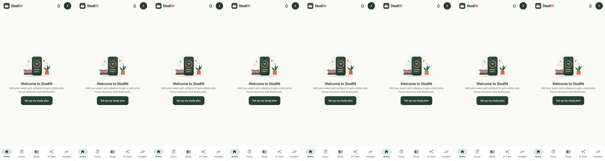</p>

<p align="center">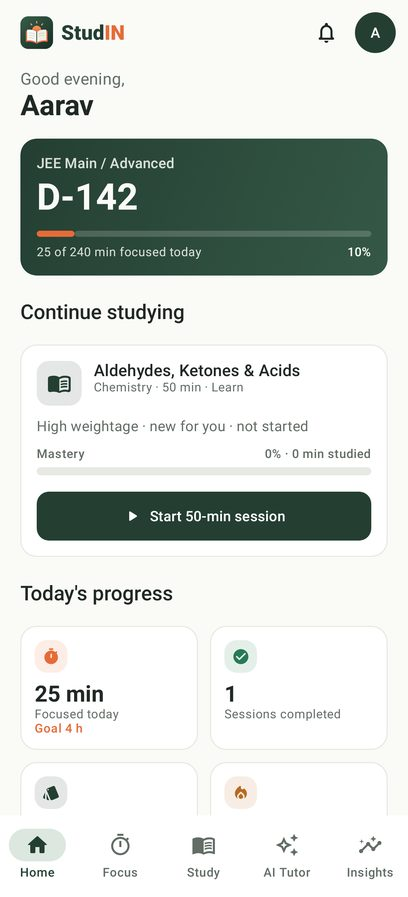 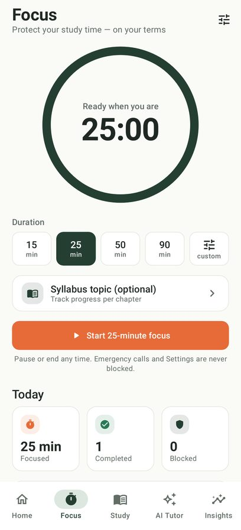 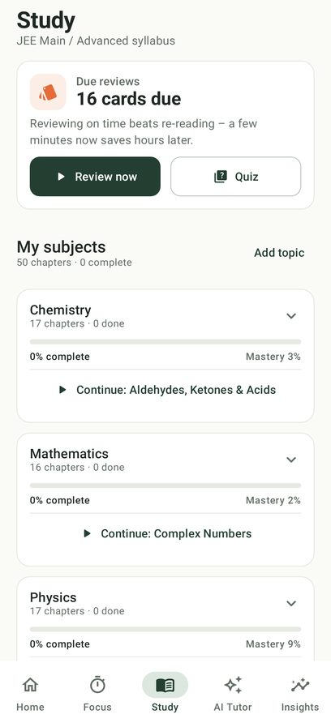 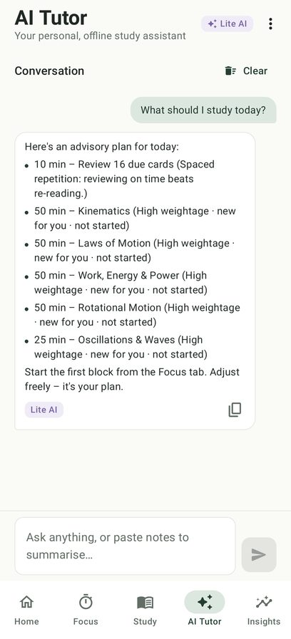 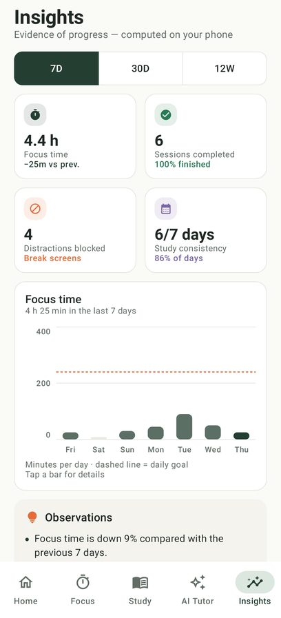</p>
<p align="center">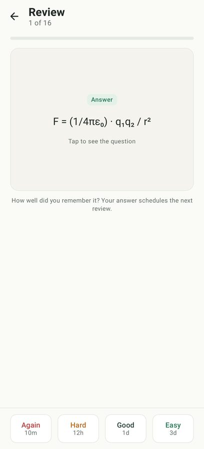 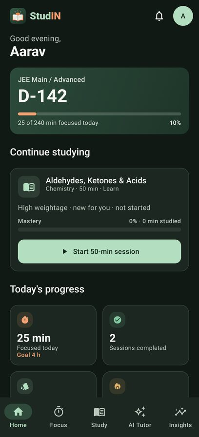 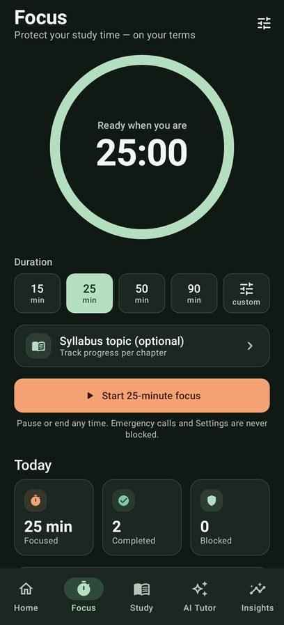 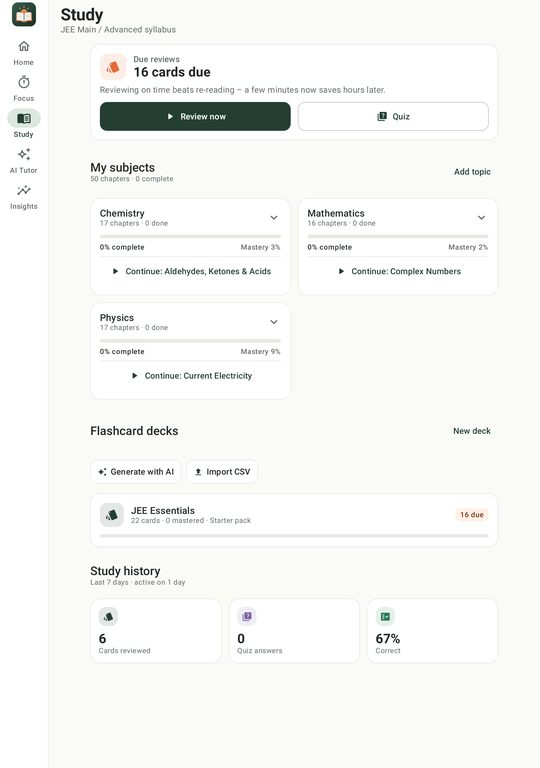 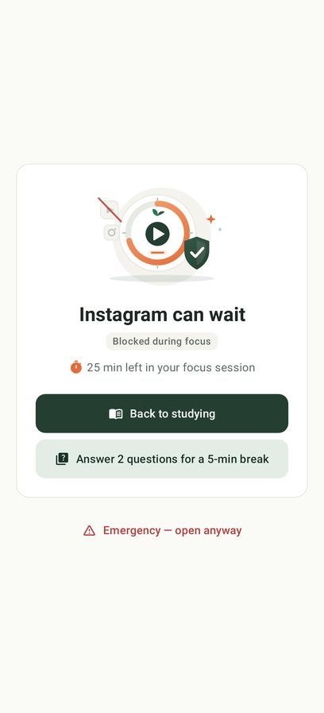</p>

**Brand** — "Rising Sun Book" logo and illustrations (vector, sources in [`design/`](design)):

<p align="center"> &nbsp; </p>

V1 → V2 comparison: [`docs/screenshots/v1_vs_v2.jpg`](docs/screenshots/v1_vs_v2.jpg).

## On-device AI tiers

| Tier | What | Where |
|---|---|---|
| 0 | Your allow/block keyword lists | `ContentClassifier` |
| 1 | Normalised n-gram lexicon (English + Hinglish + Devanagari) + weights generated from **your** syllabus, calibrated with a logistic link. BLOCK only at high confidence with ≥ 2 signals; uncertain content is allowed. | `core/domain/.../classifier` |
| Lite | Extractive flashcards, summarisation, BM25 retrieval, study planner | `core/domain/.../ai/LiteAi.kt` |
| 2 (optional) | Google **LiteRT-LM** running **Qwen2.5 1.5B** (4–6 GB RAM) or **Qwen3 4B** (8 GB+), picked from the phone's RAM, downloaded in-app from Hugging Face (pinned + SHA-256 verified); GPU (OpenCL) with crash-safe CPU fallback; power-aware. Older Gemma 3 1B `.task` files still run on MediaPipe. | `app/.../ai/OnDeviceLlm.kt`, `ModelCatalog.kt`, `GpuPolicy.kt`, `LocalEngines.kt` |

### Getting the full AI Tutor (picked by RAM)
Open **AI Tutor** → **Download AI Tutor** → confirm. StudIN reads the phone's total RAM
(`ActivityManager.MemoryInfo.totalMem`) and offers the largest model that runs comfortably:

| Phone RAM (box size) | Android reports | Model | File | Size |
|---|---|---|---|---|
| 8 GB and up | ≥ 7.0 GB | **Qwen3 4B** (thinking mode off) | [`litert-community/Qwen3-4B`](https://huggingface.co/litert-community/Qwen3-4B) · `qwen3_4b_mixed_int4.litertlm` @ `0c8dd54` | 2.3 GB |
| 4 – 6 GB | 3.3 – 7.0 GB | **Qwen2.5 1.5B Instruct** | [`litert-community/Qwen2.5-1.5B-Instruct`](https://huggingface.co/litert-community/Qwen2.5-1.5B-Instruct) · `…_q8_ekv4096.litertlm` @ `60257f9` | 1.6 GB |
| under 4 GB or 32-bit | — | none — StudIN Lite AI only | — | — |

The download runs in the background (progress notification, resumes if interrupted), is pinned to
the repository revision above and verified against its SHA-256 before it replaces any older model.
Both repositories are public and Apache-2.0 licensed, so **no Hugging Face account or token is
needed**. Already have a `.litertlm` / `.task` file? **⋮ → Import model file**.

**GPU acceleration.** Models run on Google's LiteRT-LM runtime, on the GPU (OpenCL, declared as
optional `uses-native-library`) when the phone has it, otherwise on the CPU. GPU drivers can crash
natively, so `GpuPolicy` records *probing* before touching the GPU and *OK* only after a short
warm-up answer; if the app dies in between, the next start uses the CPU for that model. Init errors
fall back to the CPU immediately. **⋮ → Use GPU acceleration** switches it off (or gives the GPU a
fresh try). The AI Tutor card shows whether answers run on the GPU or the CPU.

### How StudIN keeps the on-device AI under control
Small on-device models drift and invent facts (names, dates, links) if left alone, so the app decides what it may do
(`core/domain/.../ai/TutorGuard.kt`, unit-tested):

* **Intent routing** — identity, greetings, thanks, revision planning (real planner data), quiz,
  wellbeing, off-topic (syllabus classifier) and self-harm messages (Tele-MANAS 14416) are answered
  by the app; only study questions and note summaries reach the model.
* **One clean instruction turn** — strict rules first (never truncated), at most 3 relevant
  flashcards, previous exchange only for real follow-ups that use a cue word ("why?", "give an
  example") — a short new topic like "linux os" starts fresh.
* **Calm sampling** — temperature 0.3 (0.2 for summaries/cards), top-K 20, top-P 0.9.
* **Output guard** — strips role echoes/special tokens and any Qwen `<think>` block, drops
  invented links and empty bullets, cuts repetition loops, stops native generation at ~120 words
  on a sentence boundary (~220 for code questions so the code block is complete), closes open
  code blocks.
* **Honest UI** — inline markdown rendered properly and a "check important facts" note on model answers.
* **Resources** — single model load (mutex), prewarm on opening AI Tutor, unload after 3 min idle
  or on memory pressure, UI updates throttled while streaming.

## Architecture

```
:core:domain   Pure Kotlin + Java (JVM). Focus state machine, rule precedence, classifier,
               SM-2, CSV parser, quiz generator, planner, streaks, Lite AI, exam catalog.
               Fully unit-tested (incl. property/fuzz tests).
:app           Android. Compose UI + design system, Room/DataStore, Hilt, platform adapters:
  core/designsystem   Warm Academic tokens (light/dark), StudIN* components, illustrations
  core/data           Room entities/DAOs, repositories, DataStore preferences
  ai/                 OnDeviceLlm (MediaPipe), OcrEngine (ML Kit), StudyAssistant facade
  platform/focus      FocusController, FocusService, UsageStatsBridge (Java), BootReceiver
  platform/accessibility  Focus Guard (bounded, throttled inspection)
  platform/gate       Break gate activity
  feature/*           onboarding, home, focus, study, ai, insights, settings
```

Rule precedence: **emergency allowlist > user allow > session pass > app block > Smart feed rule > advisory**.

## Build

Requirements: JDK 17+ and the Android SDK (platform 36).

```bash
./gradlew :core:domain:test        # domain unit tests
./gradlew :app:assembleDebug       # app/build/outputs/apk/debug/app-debug.apk
./gradlew :app:assembleRelease     # minified, signed with the debug key for testing
./gradlew :app:testDebugUnitTest   # unit + Robolectric tests: screenshot matrix → app/build/screenshots, a11y audit → app/build/reports/a11y
```

minSdk 26 · targetSdk 36.

## Docs
* **V2 redesign**: [final report](docs/STUDIN_V2_FINAL_REPORT.md) · [audit](docs/STUDIN_V2_INITIAL_AUDIT.md) · [design system](docs/STUDIN_V2_DESIGN_SYSTEM.md) · [architecture](docs/STUDIN_V2_ARCHITECTURE.md) · [screens](docs/STUDIN_V2_SCREEN_REDESIGN.md) · [accessibility](docs/STUDIN_V2_ACCESSIBILITY_REPORT.md) · [performance](docs/STUDIN_V2_PERFORMANCE_REPORT.md) · [tests](docs/STUDIN_V2_TEST_REPORT.md) · [screenshots](docs/STUDIN_V2_SCREENSHOT_REVIEW.md)
* [Privacy policy draft](docs/PRIVACY.md)
* [Threat model](docs/THREAT_MODEL.md)
* [ADR 0001 – on-device AI tiers](docs/adr/0001-on-device-ai-tiers.md)
* [ADR 0002 – non-coercive focus](docs/adr/0002-non-coercive-focus.md)

## Honest limitations
* Accessibility can only read what apps expose; some feed apps hide titles. Smart mode then falls back to app-level rules.
* Usage-stats data is approximate on some OEM ROMs; aggressive battery savers may delay the timer service (grant the battery exemption in *Permission health*).
* Play's Accessibility API policy must be reviewed before store submission.
